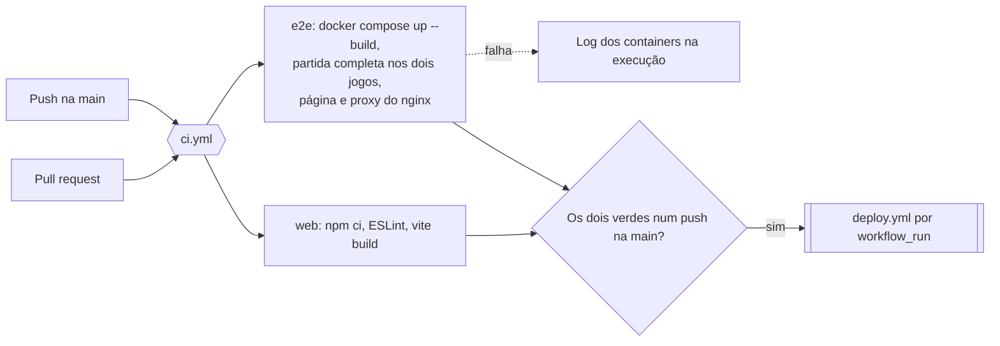
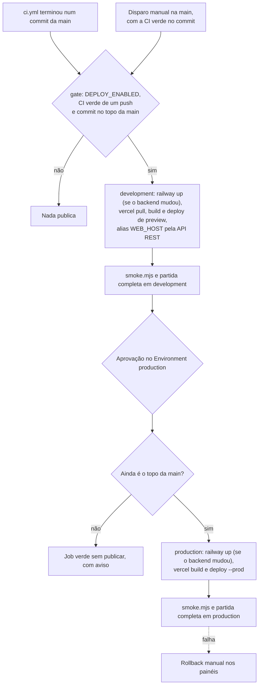

# workflows

Os dois workflows do GitHub Actions da Roda: a CI que testa cada mudança e a publicação em development e, com aprovação, em production. O passo a passo para configurar tokens, variáveis e a aprovação está em [`docs/CONFIGURAR-PIPELINE.md`](../../docs/CONFIGURAR-PIPELINE.md).

## Arquivos

| Arquivo | O que faz | Quem dispara |
|---|---|---|
| [`ci.yml`](ci.yml) | Dois jobs em paralelo: `web` (ESLint e build do frontend) e `e2e` (constrói as imagens de produção, sobe o ambiente com o docker compose e joga uma partida de cada jogo) | Toda pull request e todo push na `main` |
| [`deploy.yml`](deploy.yml) | Depois da CI verde num push na `main`: `gate`, `development`, aprovação e `production`, na Railway e na Vercel, com fumaça e uma partida de cada jogo no ambiente publicado | O `workflow_run` do `ci.yml`, ou o disparo manual na `main` |
| [`../scripts/smoke.mjs`](../scripts/smoke.mjs) | Fumaça de um ambiente publicado: espera o `/health` do backend devolver o commit, confere os jogos registrados, o CORS para a origem do frontend, a página e o endereço do backend dentro do build | Os dois jobs do `deploy.yml` e quem opera, à mão |

O teste do jogo é o [`frontend/roda-game-test.mjs`](../../frontend/roda-game-test.mjs): 26 verificações de Spyfall e Quem sou eu pelo Socket.io. A CI o roda contra o container; o deploy, contra o backend publicado. No fim ele sai das salas, para não deixar sala vazia na lista pública.

## CI

Nenhum job lê segredo. O nome `ci` é o que o `deploy.yml` escuta: renomear desliga o deploy. O job `e2e` usa o mesmo `backend/Dockerfile` da Railway, então um erro de empacotamento aparece aqui, antes de qualquer publicação.

O ESLint falha o job com erro, não com aviso. Os 9 avisos de hoje são dívida conhecida, rebaixada de erro para aviso em [`frontend/eslint.config.js`](../../frontend/eslint.config.js) (item CI-01 do [plano de ação](../../docs/PLANO-DE-ACAO.md)).

## Deploy

O `deploy.yml` faz checkout do commit que a CI testou, não do topo da `main` no momento. O `gate` e a nova conferência depois da aprovação impedem que uma CI antiga, ou uma aprovação de dias atrás, devolva código velho ao ar. Cada ambiente tem o próprio grupo de concorrência, então uma aprovação pendente de production não segura o development.

**O backend só sobe quando mudou.** As salas vivem na memória do servidor, e todo deploy na Railway o reinicia. Cada job lê o commit que está no ar em `/health` e compara `backend/`, `shared/` e `.dockerignore` com o commit novo. Sem diferença, o `railway up` fica de fora e uma mudança só de frontend não derruba quem está jogando. Para forçar um deploy do backend sem mudar o código, use **Redeploy** no painel da Railway.

O que cada ambiente publica:

| Parte | development | production |
|---|---|---|
| Backend | Railway, projeto `spyfall`, serviço `spyfall-webgame`, ambiente `dev` | O mesmo serviço, ambiente `production` |
| Frontend | Vercel, implantação de preview com o alias `WEB_HOST` | Vercel, implantação de produção |
| Build do backend | `backend/Dockerfile`, com a raiz do repositório como contexto | O mesmo |
| Endereço do backend no frontend | `API_URL` do Environment, passado como `VITE_SOCKET_URL` ao `vercel build` | O mesmo |

Segredos e variáveis, guardados em cada GitHub Environment (`development` e `production`):

| Nome | Tipo | Para que serve |
|---|---|---|
| `RAILWAY_TOKEN` | Segredo | Token do projeto na Railway, limitado a um ambiente. Só o passo do `railway up` o recebe |
| `VERCEL_TOKEN` | Segredo | Token da Vercel, para `pull`, `build`, `deploy` e o alias |
| `VERCEL_ORG_ID` e `VERCEL_PROJECT_ID` | Variáveis | O time e o projeto da Vercel |
| `API_URL` | Variável | Origem `https` do backend na Railway, sem barra no fim. Entra no build do frontend e é o alvo da fumaça |
| `WEB_HOST` | Variável | Host do frontend, sem `https://`. É o alias de development e a origem que a fumaça confere no CORS |

A variável de repositório `DEPLOY_ENABLED` liga o pipeline. O Environment `production` tem o dono do repositório como revisor obrigatório.

A publicação por Git fica desligada dos dois lados: na Vercel, pelo [`frontend/vercel.json`](../../frontend/vercel.json); na Railway, no painel de cada ambiente. A produção só muda pelo `deploy.yml`, com a aprovação.

## Testes

- Os workflows não têm teste automático: a prova é a própria execução.
- Para rodar a fumaça à mão: `node .github/scripts/smoke.mjs https://<WEB_HOST> https://<API_URL> [commit]`, da raiz do repositório.
- Para rodar o teste do jogo à mão: `node frontend/roda-game-test.mjs https://<API_URL>`, depois de `npm ci` em `frontend/`.
- Para repetir o job `e2e` na máquina: `docker compose up --build -d --wait` e `docker compose --profile test run --rm smoke`.

## O que ficou de fora

- Zerar os avisos do ESLint e voltar as duas regras para erro (CI-01).
- `npm audit` e Dependabot: há vulnerabilidades conhecidas nas dependências (SEG-03), e um passo de auditoria nasceria vermelho.
- Testes de unidade das regras dos jogos (ARQ-05). Quando existirem, entram como mais um passo ou job do `ci.yml`.
- Rollback automático: se a fumaça de produção falha, o job fica vermelho e a volta é manual.
